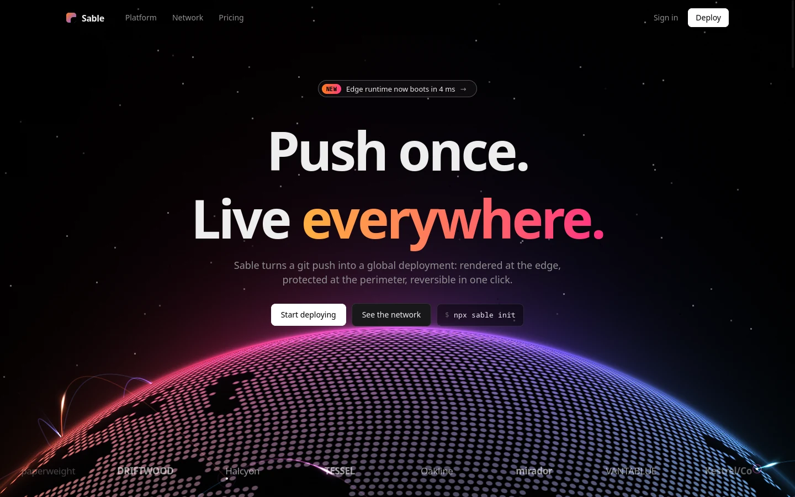
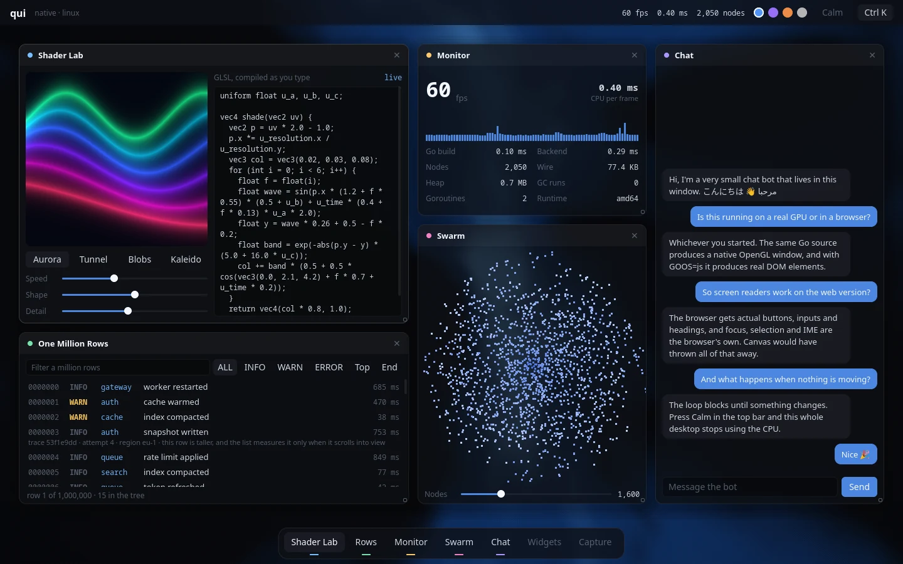
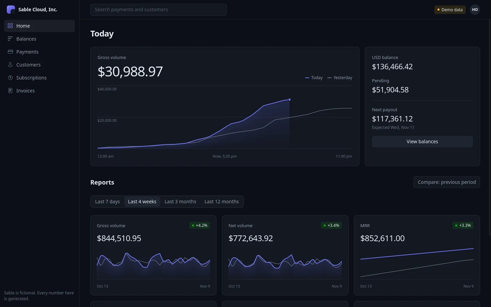
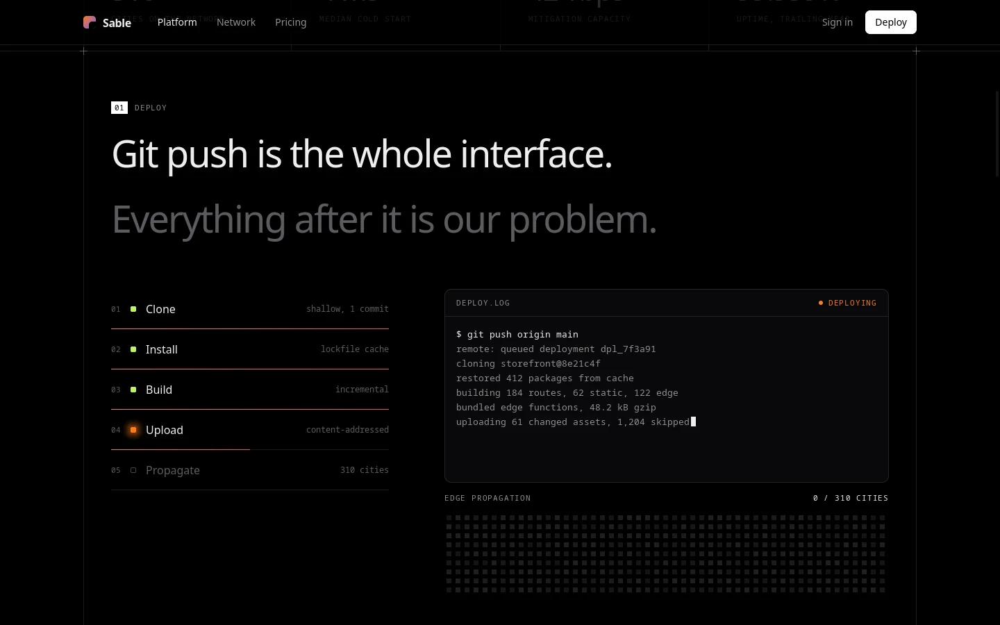
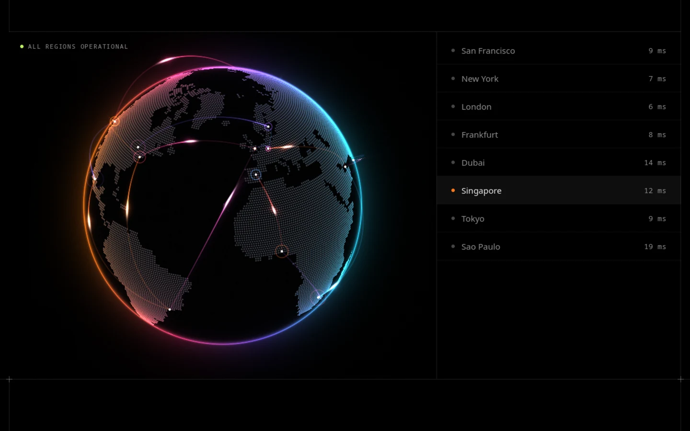

# qui

One UI API for native apps and the real browser DOM. Write it once in Go or C++.



> **Agents:** read [`SKILL.md`](SKILL.md) first, then see [For agents](#for-agents).

You rebuild the whole interface every frame from your own variables. There are no widget objects, callbacks or bindings, and `Frame()` blocks until something changes, so an idle app uses no CPU.

```go
package main

import (
	"strconv"

	"github.com/torisetxd/qui"
)

func main() {
	ui := qui.Open("Counter", 480, 320)
	defer ui.Close()
	count := 0
	for ui.Frame() {
		ui.Column(qui.Style{W: qui.Fill(), H: qui.Fill(), Pad: qui.All(16), Gap: 8}, func() {
			ui.Text("Counter", qui.H1)
			ui.Text(strconv.Itoa(count))
			if ui.Button("Add").Clicked {
				count++
			}
		})
	}
}
```

`go run .` opens a native window. Build the same file with `GOOS=js GOARCH=wasm` and it renders real HTML elements in the browser.

C++ is the same API in `snake_case`:

```cpp
#include "qui.hpp"
#include <string>
using namespace qui;

int main() {
  Ui ui("Counter", 480, 320);
  int count = 0;
  while (ui.frame()) {
    ui.column({.w = fill(), .h = fill(), .pad = 16, .gap = 8}, [&] {
      ui.text("Counter", H1);
      ui.text(std::to_string(count));
      if (ui.button("Add").clicked) ++count;
    });
  }
}
```

## Examples

Each one is a plain qui app, shown here on the native GPU renderer. The companies and numbers are made up.

| Showcase | Billing dashboard |
| --- | --- |
|  |  |

| Landing page: deploy section | Landing page: network section |
| --- | --- |
|  |  |

Run them from the repo root:

| App | Native window | Browser, at `127.0.0.1:8080` |
| --- | --- | --- |
| Showcase | `go run ./examples/showcase` | `go run ./examples/showcase/serve` |
| Landing page | `go run ./examples/landing` | `go run ./examples/landing/serve` |
| Billing dashboard | `go run ./examples/billing` | `go run ./examples/billing/serve` |

## Features

- **Layout:** a strict flexbox subset (`Column`, `Row`, `Stack`) that maps directly to CSS.
- **Text:** HarfBuzz shaping and mixed-direction text. Inputs have selection, undo, clipboard and IME.
- **Virtual lists:** `List` builds only the visible rows, and row heights can vary.
- **Shaders:** write one GLSL function and place it like any other box.
- **Styling:** gradients on boxes and text, box shadows, letter spacing and four built-in themes.
- **Renderers:** OpenGL ES 3.0 or desktop GL 3.3, with a CPU rasterizer as the fallback.
- **Real DOM on the web:** actual buttons, inputs and headings, with roles and labels for screen readers.
- **Linux desktop tools:** `qui/sys` handles `.desktop` install, background services, and screen and microphone capture with saved permissions.

## Status

| Target | State |
| --- | --- |
| Linux native | Works |
| Browser (Go wasm) | Works, tested in Firefox |
| Windows, Android | Not built yet |

Also missing: images, touch gestures, right-to-left paragraph direction and global shortcuts.

## Getting started

You need Go 1.24 or newer. Native builds also need `sdl3 freetype2 harfbuzz fontconfig` through pkg-config, and `qui/sys` needs `gio-2.0 gio-unix-2.0 libpipewire-0.3`.

Clone qui next to your app:

```sh
git clone https://github.com/torisetxd/qui ../qui
```

**Go:** add this to `go.mod`:

```
require github.com/torisetxd/qui v0.0.0

replace github.com/torisetxd/qui => ../qui
```

**C++:** add this to `CMakeLists.txt`, with qui checked out as a subfolder. It needs C++20.

```cmake
add_subdirectory(qui)
target_link_libraries(app PRIVATE qui)
```

### Ship to the web

Install the CLI once from this repo, then build any qui app into a static folder:

```sh
go install ./cmd/qui
qui build ./myapp -title "My app" -bg "#000"
```

That writes `myapp/dist` with a stripped wasm, one minified JS bundle, hashed filenames and `.br` and `.gz` copies. Add an `index.html` to your app folder to replace the generated page, and a `public/` folder for favicons and fonts. Your host must serve `.wasm` as `application/wasm`.

## How it works

```
your app (Go or C++)
   |  one flat byte stream per frame
   |
   |-- native   engine: layout, text, paint  ->  OpenGL or CPU  ->  SDL window
   `-- browser  web/qui.js: patches real DOM elements
```

Both sides read the same stream, so a new language only needs an encoder. Input comes back as a `Response` on the next frame. The format is documented in [`docs/wire.md`](docs/wire.md).

## For agents

[`SKILL.md`](SKILL.md) covers the whole API in about 4,000 tokens: the rules that cause most mistakes, every style field, build commands and what doesn't exist yet. To install it as a skill, copy it to `~/.claude/skills/qui/SKILL.md` or your tool's equivalent.

Check your work without opening a window. These run from the repo root and exit on their own:

| Goal | Command |
| --- | --- |
| Screenshot | `QUI_SHOT=a.png QUI_SIZE=1440x900 go run ./examples/billing` |
| Screenshot with shaders | `QUI_BACKEND=gl QUI_FRAMES=1500 QUI_SHOT=a.png go run ./examples/billing` |
| Every node's rect and text | `QUI_TREE=a.json go run ./examples/billing` |
| Click, then screenshot | `QUI_DRIVE='click:116,152' QUI_SHOT=a.png go run ./examples/billing` |

- Offscreen runs use the CPU renderer unless you set `QUI_BACKEND=gl`, and the CPU renderer skips shaders.
- Frames run faster than real time offscreen, so raise `QUI_FRAMES` if an animation hasn't settled.
- `SKILL.md` lists every scripted input step, including typing, dragging and scrolling.

When changing the framework itself:

- To add a node kind, op or token, edit `spec.txt` and run `go run ./tools/gen`. Never hand-edit the generated `wire_gen.go`, `wire.gen.hpp` or `web/wire.gen.js`.
- Rendering changes need checking on `QUI_BACKEND=gl`, `QUI_BACKEND=cpu` and in a browser.

### Repo map

| Path | What it is |
| --- | --- |
| `qui.go`, `frame_native.go`, `frame_js.go` | Go API and its native and wasm frame loops |
| `qui.hpp`, `qui_c.h` | C++ API and the C ABI |
| `engine.cpp` | Decodes frames, runs layout, builds paint lists and damage |
| `app.cpp`, `input.cpp` | Window, events, offscreen mode and text editing |
| `gl.cpp`, `cpu.cpp` | GPU and CPU renderers |
| `font_manager.cpp`, `text_shaper.cpp` | Fonts, glyph cache and shaping |
| `web/qui.js` | Browser DOM patcher |
| `spec.txt`, `tools/gen` | Wire format source and code generator |
| `cmd/qui` | The `qui build` command |
| `sys/` | Linux install, services and capture |
| `examples/` | Showcase, landing page and billing dashboard |
